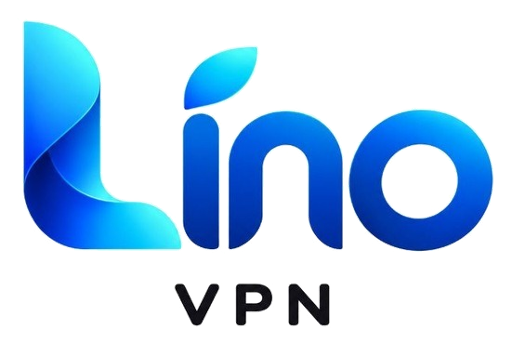

  <picture>
    <source media="(prefers-color-scheme: dark)" srcset="docs/logo-dark.png">
    <source media="(prefers-color-scheme: light)" srcset="docs/logo-light.png">
    
  </picture>

  <h1>LinoVPN for Android &amp; Windows</h1>
  
<b>Fast, Smart &amp; Censorship-Resistant VPN Client — Powered by Xray-core, Aether (WARP), Unbar &amp; SlipNet</b>

  

    <a href="README.md">🇮🇷 فارسی (Default)</a> •
    <a href="README.en.md"><b>🇬🇧 English</b></a>
  

  

    
    
    
  

---

## 📥 Direct Download (`v3.0.5`)

### 📱 Android &amp; Android TV

> **Seamless In-Place Upgrades:** All official **LinoVPN** Android builds are signed with our permanent dedicated release keystore. Future updates install directly over your existing installation **without uninstalling or losing your subscriptions**.

| Architecture / Variant | Recommended For | Direct Download |
| :--- | :--- | :---: |
| **ARM64 (`arm64-v8a` — v8)** | ✅ **Recommended** for almost all modern 64-bit Android phones &amp; Android TVs (smaller size) | [⬇️ Download (arm64-v8a)](https://github.com/HamidOffline/linovpn/releases/download/v3.0.5/LinoVPN_3.0.5_arm64-v8a.apk) |
| **ARMv7 (`armeabi-v7a` — v7)** | Older 32-bit Android phones, tablets &amp; TV boxes | [⬇️ Download (armeabi-v7a)](https://github.com/HamidOffline/linovpn/releases/download/v3.0.5/LinoVPN_3.0.5_armeabi-v7a.apk) |
| **Universal** | Works on both 64-bit &amp; 32-bit ARM Android devices (if you are unsure) | [⬇️ Download (Universal)](https://github.com/HamidOffline/linovpn/releases/download/v3.0.5/LinoVPN_3.0.5_universal.apk) |

### 💻 Windows (Windows 10 / 11 — 64-bit)

| Windows Package | Description | Direct Download |
| :--- | :--- | :---: |
| **Installer (`Setup.exe`)** | ✅ **Recommended** — Full installer with desktop shortcut, Start with Windows &amp; in-app updates | [⬇️ Download Windows Installer](https://github.com/HamidOffline/linovpn/releases/download/v3.0.5/LinoVPN_3.0.5_Windows_x64_Setup.exe) |
| **Portable (`Portable.zip`)** | No installation required — extract anywhere and launch `LinoVPN.exe` | [⬇️ Download Windows Portable](https://github.com/HamidOffline/linovpn/releases/download/v3.0.5/LinoVPN_3.0.5_Windows_x64_Portable.zip) |

> 📦 Browse all releases and changelogs on the [GitHub Releases](https://github.com/HamidOffline/linovpn/releases) page.

---

## ✨ Key Features

### ⚡ Smart Connection &amp; Unified Modern UI (Android, Android TV &amp; Windows)
- **Zero-Friction Onboarding:** Paste your subscription link or config on first launch to automatically import, test ping, and connect to the fastest server.
- **Auto-Ping &amp; Smart Auto-Connect on Launch:** Tests all servers in the active tab on startup and connects to the lowest-ping primary server—with automatic fallback to **Unbar** DNS tunnels if standard protocols are blocked.
- **Floating Capsule Status Bar:** Clean status capsule showing real ping latency, **exit country &amp; IP**, **real-time Download/Upload speeds**, and **total session traffic volume**.
- **Subscription Usage Card:** Displays traffic usage, remaining quota bar, expiry date, support shortcut, **subscription refresh**, and **one-tap batch ping**.
- **Dedicated Android TV Experience:** Full D-pad remote navigation across servers, settings, editors, Unbar, SlipNet, and DNS Scanner.
- **Native Windows Integration:** Instant switching between **System Proxy** (zero admin required), **TUN Mode (Wintun)** for all apps &amp; games, and **Local Port**, plus System Tray support, live server switching while connected, and resizable/fullscreen window.
- **Instant Light &amp; Dark Mode (🌙 / ☀️) &amp; Pure Bilingual UI (Persian / English):** Clean localization across every menu and setting with automatic in-app update checks and downloads.

### 🚀 Latest Xray-core (`v26.11.24`) &amp; Anti-Censorship Suite
- Full protocol and transport coverage:
  - `VLESS` (`Reality`, `XHTTP`, **`xDrive`**, `ML-KEM 768`, `Vision`, `HTTPUpgrade`, `WebSocket`, `gRPC`, `TCP`)
  - `VMess`, `Trojan`, `Shadowsocks`, `Hysteria2` (with global port hopping interval &amp; Gecko/Salamander obfs), `WireGuard`, `MASQUE` (IPv6 &amp; IP-only remote DNS), `SOCKS5`, `HTTP`
- Complete **FinalMask** controls (including **XDNS `alphabet`** for UDP/53 networks), **TLS Fragment**, **UDP Noise**, **CurvePreferences**, **Session Resumption**, **ECH**, **editable ALPN**, and **TCP User Timeout**.
- **Advanced DNS Controls:** Domestic DNS region validation (`expectIPs`), **Parallel DNS Queries** (`enableParallelQuery`), and **Serve Stale** cache fallback (`serveStale`).
- **Proxy Chains**, **Policy Groups** (`LeastPing` / `LeastLoad`), **Multi-Outbound Custom JSON**, and **Import Routing Rulesets from URL / JSON**.
- Built-in **Aether (WARP)**, **Psiphon**, and **Tor** with interactive endpoint scanner and one-click WARP key renewal.
- **Per-App Proxy (Android)**, **Iran-optimized GeoIP / GeoSite assets**, and full Backup &amp; Restore.

### 📡 Unbar (Soar DNS Tunnel) with Dedicated Settings
- Native **Unbar (Soar)** engine for bypassing extreme censorship and blackouts over DNS.
- Native support for `unbar://` URIs, Unbar JSON arrays, and automatic subscription header injection.
- Dedicated **Unbar Settings** screen separate from Xray settings: VPN / Proxy / SOCKS5 modes, **Auto-Discovery across 2,307 verified resolvers** or custom resolvers, **TCP-53 / UDP-53** modes, MTU &amp; Max DNS Answer tuning, bandwidth limits, domestic `.ir` geo-bypass, and diagnostic logs.

### 🛡️ Full SlipNet Engine + Built-In 6-Test DNS Scanner
- Complete **SlipNet** protocol suite:
  - **DNSTT** &amp; **NoizDNS** (Stealth &amp; Authoritative modes)
  - **VayDNS** (DNS record type, DNSTT compatibility, Max QNAME, RPS limit &amp; timeout tuning)
  - **Soar** &amp; **Slipstream QUIC** (`BBR` / `DCUBIC` congestion control &amp; `UDP GSO`)
  - **NaiveProxy**, **SSH Tunnel** (TLS / SNI / WebSocket / Custom Payload Injection), **DoH**, and **Tor** (`Snowflake` / `obfs4` / `Meek`)
- Native decryption of **`slipnet-enc://`** encrypted configs alongside `slipnet://`.
- **Built-in Multi-Threaded 6-Test DNS Scanner:** Scans 2,307 verified resolvers, Iran Lite/Full CIDR pools, or custom IP/CIDR files, scores tunnel readiness (0–6), and applies the best resolvers to **Unbar** or **SlipNet** in one click.

---

## 📞 Community &amp; Support
- **Official Telegram Channel:** [@LinoVPN](https://t.me/LinoVPN)
- **Customer Support:** [@LinoVPNSup](https://t.me/LinoVPNSup)
- **Bug Reports &amp; Feature Requests:** [GitHub Issues](https://github.com/HamidOffline/linovpn/issues)
