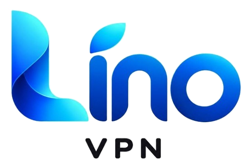

  <picture>
    <source media="(prefers-color-scheme: dark)" srcset="docs/logo-dark.png">
    <source media="(prefers-color-scheme: light)" srcset="docs/logo-light.png">
    
  </picture>

  <h1>LinoVPN برای اندروید</h1>
  
<b>کلاینت هوشمند، سریع و مقاوم در برابر محدودیت‌های اینترنتی — ترکیبی از Xray-core، PattNG، Unbar و SlipNet</b>

  

    <a href="README.md"><b>🇮🇷 فارسی (پیش‌فرض)</b></a> •
    <a href="README.en.md">🇬🇧 English</a>
  

  

    
    
    
  

---

## 📥 دانلود مستقیم آخرین نسخه (`v3.0.4`)

> **نکته مهم درباره به‌روزرسانی:** تمام نسخه‌های رسمی **LinoVPN** با کلید امضای اختصاصی و دائمی منتشر می‌شوند؛ بنابراین برای نصب نسخه‌های جدیدتر **هیچ نیازی به حذف نسخه قبلی یا وارد کردن دوباره اشتراک نیست** و به‌روزرسانی مستقیم روی نسخه قبلی نصب می‌شود.

| نسخه / معماری پردازنده | توضیح و دستگاه‌های سازگار | لینک دانلود مستقیم |
| :--- | :--- | :---: |
| **ARM64 (`arm64-v8a` — معماری ۸)** | ✅ **پیشنهادی** برای تقریباً تمام گوشی‌های جدید اندروید (۶۴ بیتی) — حجم سبک‌تر | [⬇️ دانلود مستقیم (arm64-v8a)](https://github.com/HamidOffline/linovpn/releases/download/v3.0.4/LinoVPN_3.0.4_arm64-v8a.apk) |
| **ARMv7 (`armeabi-v7a` — معماری ۷)** | مناسب گوشی‌ها و تبلت‌های قدیمی‌تر اندروید (۳۲ بیتی) | [⬇️ دانلود مستقیم (armeabi-v7a)](https://github.com/HamidOffline/linovpn/releases/download/v3.0.4/LinoVPN_3.0.4_armeabi-v7a.apk) |
| **Universal (یونیورسال)** | قابل نصب روی هر دو معماری ۳۲ و ۶۴ بیتی (اگر از معماری گوشی خود مطمئن نیستید) | [⬇️ دانلود مستقیم (Universal)](https://github.com/HamidOffline/linovpn/releases/download/v3.0.4/LinoVPN_3.0.4_universal.apk) |

> 📦 همچنین می‌توانید تمام نسخه‌ها و جزئیات تغییرات را در صفحه [Releases](https://github.com/HamidOffline/linovpn/releases) مشاهده کنید.

---

## ✨ امکانات و قابلیت‌های کلیدی LinoVPN

### ⚡ اتصال هوشمند و رابط کاربری مدرن
- **راه‌اندازی سریع در اولین اجرا:** با باز کردن برنامه، لینک اشتراک یا کانفیگ را وارد کنید تا سرورها دریافت، پینگ‌گیری و سریع‌ترین سرور به‌صورت خودکار متصل شود.
- **پینگ خودکار و اتصال به بهترین سرور در شروع برنامه:** در هر بار اجرای برنامه (در صورت قطع بودن)، تمام سرورهای تب فعال پینگ گرفته می‌شوند و سریع‌ترین سرور پایدار به‌طور خودکار انتخاب و متصل می‌شود؛ در صورت اختلال کامل روی پروتکل‌های اصلی، به‌صورت هوشمند به نودهای اضطراری **Unbar** سوئیچ می‌کند.
- **نوار وضعیت کپسولی پیشرفته:** نمایش پینگ واقعی، **کشور و آی‌پی خروجی**، **سرعت لحظه‌ای دانلود و آپلود** و **حجم مصرفی کل همان اتصال** بدون شلوغی اضافه.
- **کارت اطلاعات اشتراک کامل:** نمایش حجم مصرفی، تاریخ انقضا، نوار پیشرفت حجم، لینک پشتیبانی و دکمه‌های اختصاصی **رفرش اشتراک** و **پینگ یک‌جا**.
- **نمای فشرده دو ستونه و تک‌ستونه:** چیدمان جمع‌وجور و سریع برای مدیریت ده‌ها سرور با قابلیت مرتب‌سازی خودکار بر اساس کمترین پینگ.
- **تغییر آنی حالت روز و شب (🌙 / ☀️):** دکمه اختصاصی در نوار بالای صفحه اصلی با پالت رنگی هماهنگ با لوگوی LinoVPN و لوگوی مجزای روز و شب.
- **دوزبانه کامل (فارسی و انگلیسی):** ترجمه خالص و یکپارچه در تمام منوها، واحدهای سرعت، حجم و پینگ.
- **اعلان خودکار نسخه جدید و آپدیت درون‌برنامه‌ای:** با انتشار هر نسخه جدید در گیت‌هاب، نوتیفیکیشن و بنر اطلاع‌رسانی داخل برنامه نمایش داده می‌شود و فایل متناسب با معماری گوشی شما مستقیم درون برنامه دانلود و نصب می‌شود.

### 🚀 هسته قدرتمند Xray-core و امکانات پیشرفته PattNG
- مبتنی بر جدیدترین هسته **Xray-core v26.11.23** با پشتیبانی کامل از:
  - `VLESS` (از جمله `Reality`، `XHTTP`، `ML-KEM 768`، `Vision`، `HTTPUpgrade`، `WebSocket`، `gRPC`، `TCP`)
  - `VMess`، `Trojan`، `Shadowsocks`، `Hysteria2`، `WireGuard`، `SOCKS5`، `HTTP`
- پشتیبانی کامل از **FinalMask**، **TLS Fragment**، **CurvePreferences**، **Session Resumption**، **ECH** و **TCP User Timeout**.
- پشتیبانی از **زنجیره پروکسی (Proxy Chains)**، **گروه‌های سیاستی و لودبالانسینگ (Policy Groups / LeastPing / LeastLoad)** و **ویرایشگر JSON خروجی سفارشی**.
- پشتیبانی داخلی از **Aether (WARP)**، **Psiphon** و **Lyrebird**.
- **تقسیم تونل برنامه‌ها (Per-App Proxy)**، **قوانین مسیریابی سفارشی (Routing Rules)**، فایل‌های **GeoIP / GeoSite**، پشتیبان‌گیری و بازیابی کامل تنظیمات و کاشی دسترسی سریع (Quick Settings Tile).

### 📡 تونل ضدقطعی Unbar (Soar DNS Tunnel) با تنظیمات مجزا
- هسته بومی و مستقل **Unbar (Soar)** برای عبور از شدیدترین محدودیت‌ها و شرایط قطعی از بستر DNS.
- پشتیبانی مستقیم از لینک‌های `unbar://`، ساب‌های JSON آنبار و تزریق خودکار نودهای Unbar داخل همان لینک اشتراک اصلی (همیشه مرتب در انتهای لیست سرورها).
- صفحه **تنظیمات اختصاصی آنبار** جدا از تنظیمات Xray شامل: انتخاب حالت VPN یا SOCKS5، جستجوی خودکار در **۲۳۰۷ ریزالور تاییدشده ایران** یا ریزالورهای دلخواه، حالت **TCP-53**، تنظیم MTU و Max DNS Answer، محدودیت پهنای باند دانلود/آپلود، عبور مستقیم سایت‌های ایرانی (`.ir`)، دامنه‌های مستثنی دلخواه و گزارش‌های عیب‌یابی.

### 🛡️ موتور کامل SlipNet + اسکنر داخلی DNS
- ادغام کامل تمام پروتکل‌های نسخه Full پروژه **SlipNet**:
  - **DNSTT** و **NoizDNS** (با حالت Stealth و Authoritative)
  - **VayDNS** (تنظیم نوع رکورد DNS، سازگاری DNSTT، Max QNAME، RPS و تایم‌اوت‌ها)
  - **Soar** و **Slipstream QUIC** (با کنترل ازدحام `BBR` / `DCUBIC` و `UDP GSO`)
  - **NaiveProxy**، **SSH Tunnel** (با پشتیبانی TLS / SNI / WebSocket / Payload Injection)، **DoH**
  - **شبکه Tor** همراه با پل‌های **Snowflake**، **obfs4**، **Meek** و پل‌های دلخواه
- پشتیبانی بومی از رمزگشایی لینک‌های رمزنگاری‌شده **`slipnet-enc://`** علاوه بر `slipnet://`.
- **اسکنر اختصاصی DNS داخلی:** اسکن چندرشته‌ای از میان ۲۳۰۷ ریزالور ایران، رنج‌های CIDR سبک و کامل ایران یا لیست دلخواه شما، تشخیص ریزالورهای سالم و پشتیبانی از EDNS0، و **اعمال یک‌کلیکی بهترین ریزالورها روی Unbar یا SlipNet**.

---

## 📞 ارتباط و پشتیبانی
- **کانال رسمی تلگرام:** [@LinoVPN](https://t.me/LinoVPN)
- **پشتیبانی آنلاین:** [@LinoVPNSup](https://t.me/LinoVPNSup)
- **گزارش مشکل و پیشنهادها:** [GitHub Issues](https://github.com/HamidOffline/linovpn/issues)

